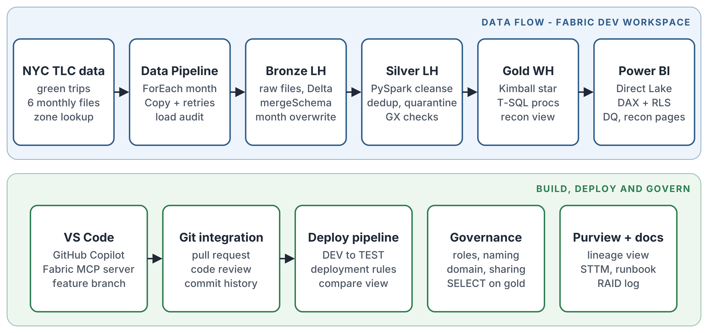

# FareFlow

A Microsoft Fabric delivery project for a fictional client, **Metro Mobility Office**, a city regulator for street-hail taxis. The client received monthly trip files, built revenue reports by hand in Excel and could never make the totals match the source. FareFlow replaces that with a governed medallion platform where every number reconciles from source file to report.

Public NYC TLC green taxi trip data (October 2024 to March 2025) stands in for the client's files. The data contains a real schema change: TLC added `cbd_congestion_fee` from January 2025.

## What it does

| Layer | Item | What happens |
|---|---|---|
| Ingest | `pl_ingest_green` | ForEach over a months parameter, HTTP Copy (Binary) of each monthly file into `lh_bronze/Files/landing`, two retries per copy |
| Bronze | `nb_bronze_load` | Parquet to Delta table `green_trips`, partitioned by `year_month`. Declared types for known columns, `mergeSchema` for new ones, `replaceWhere` so each month is replaced not appended. Writes `ops_load_audit` |
| Silver | `nb_silver_trips` | Snake case names, decimal money columns, `trip_key` hash, dedup on latest ingestion, quarantine with a reason, unknown zone member. Writes `trips`, `trips_quarantine`, `zones`, `dim_date` and `ops_silver_audit` |
| Quality | `nb_dq_gx` | Great Expectations suite on silver. Results to `ops_dq_results`. Fails the run if any expectation fails |
| Gold | `wh_gold` | Kimball star in T-SQL: `fact_trip` plus date, zone (role-playing), payment type, rate code and vendor dimensions. `usp_load_gold` reloads one month or all. `vw_reconciliation` checks every month |
| Model | `sm_mobility` | Direct Lake semantic model with DAX measures, descriptions and a borough RLS role |
| Report | `rpt_mobility` | Overview page plus a data quality and reconciliation page |
| Orchestration | `pl_master` | Ingest, bronze, silver, GX, gold in sequence with retries. Failure path logs to `ops_pipeline_runs` and fails the run |
| Release | `dp_fareflow` | Deployment pipeline from DEV to TEST with a default lakehouse rule |

## How to run

1. Open `pl_master` in `FareFlow [DEV]` and click Run.
2. `p_months` takes a comma-separated list, for example `2025-01` to reload one month. Re-runs never duplicate data.
3. Check `wh_gold.dbo.ops_pipeline_runs` for the run status and report page 2 for reconciliation.

## Data quality and reconciliation

- **Quarantine on the way in:** invalid rows go to `trips_quarantine` with a `dq_reason` instead of being dropped.
- **Great Expectations on the way out:** six expectations on silver (unique key, not null, dropoff after pickup, total range, payment code set). A planted bad row was used to prove the run fails.
- **Reconciliation:** for every month, file rows = bronze rows, bronze = silver + quarantine + duplicates removed and silver = gold in both rows and money. The report shows the difference between report revenue and source revenue, which is $0.00.

## Security and governance

- Workspace naming standard (`pl_`, `nb_`, `lh_`, `wh_`, `sm_`, `rpt_`) and a `Mobility` domain.
- Borough RLS role (`Manhattan Analyst`) in the semantic model.
- Test analyst shared on `wh_gold` and `rpt_mobility` only, `GRANT SELECT` on the gold schema with `DENY` on `ops_pipeline_runs`. Silver was never shared. The analyst is not in any workspace role because Admin and Member bypass RLS and Viewer exposes every layer.
- The semantic model uses a fixed identity connection so viewers do not need warehouse permissions and RLS does the filtering.

## Ways of working

- DEV workspace connected to GitHub. Changes go through feature branches and pull requests.
- `nb_silver_trips` was drafted by GitHub Copilot in VS Code using the Fabric MCP server to read the real table schemas, then reviewed against a checklist before merging. The review caught a broken Fabric notebook file format (each cell's metadata placed before its code) and an always-null column in the silver table.
- Deployment pipeline promotes releases from DEV to TEST.

## Decision log

| Decision | Why |
|---|---|
| Binary copy for ingestion | Lands an untouched raw copy and keeps schema handling in Spark, so a new source column cannot break the copy |
| `replaceWhere` per month | Idempotent loads and targeted backfills |
| Declared types plus `mergeSchema` in bronze | Stops type drift between monthly files while still absorbing new columns |
| Quarantine with reasons rather than dropping rows | Nothing disappears silently and the client can review rejected rows |
| Warehouse for gold | Full T-SQL with stored procedures, familiar to SQL-skilled client teams |
| Snapshot tables for reconciliation and DQ | Direct Lake reads tables, not views |
| Great Expectations after quarantine | Independent check that the rules worked |
| Failure handler on the last step via On failure and On skip | One handler fires whichever step fails |
| Fixed identity on the semantic model | Viewers only need report access and RLS still applies |

## Known limitations

- Runs on a Fabric trial capacity. Moving to a paid F capacity in the same region keeps everything working.
- Public data with a single month's worth of late arrivals allowed (one day either side of the file month).
- The lakehouse SQL endpoint can lag behind Spark writes. See the runbook.

## Docs

- [Source-to-target mapping](docs/sttm.md)
- [Runbook](docs/runbook.md)
- [RAID log](docs/raid_log.md)
- [Phase 2 proposal](docs/phase2_proposal.md)
